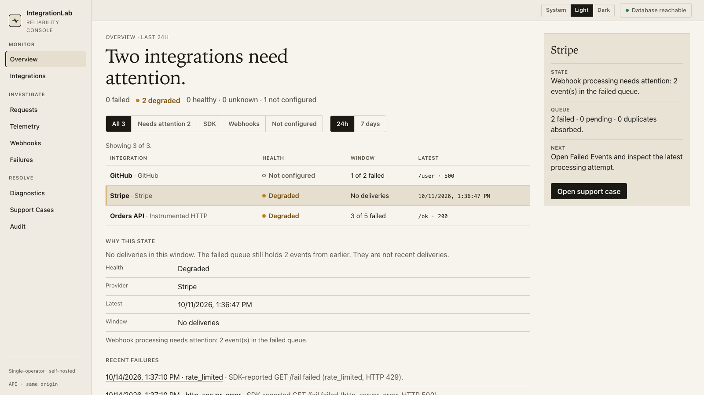
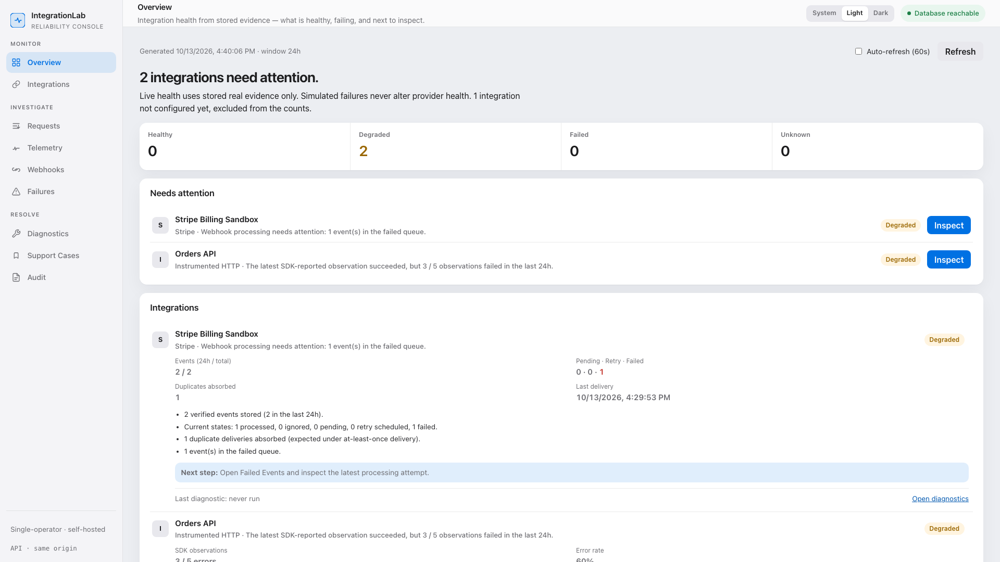
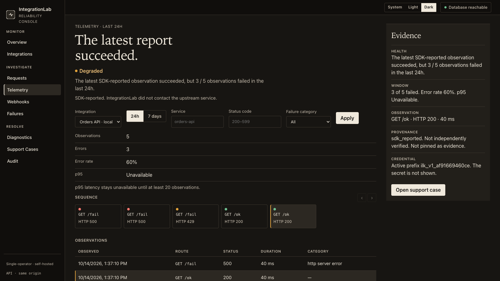
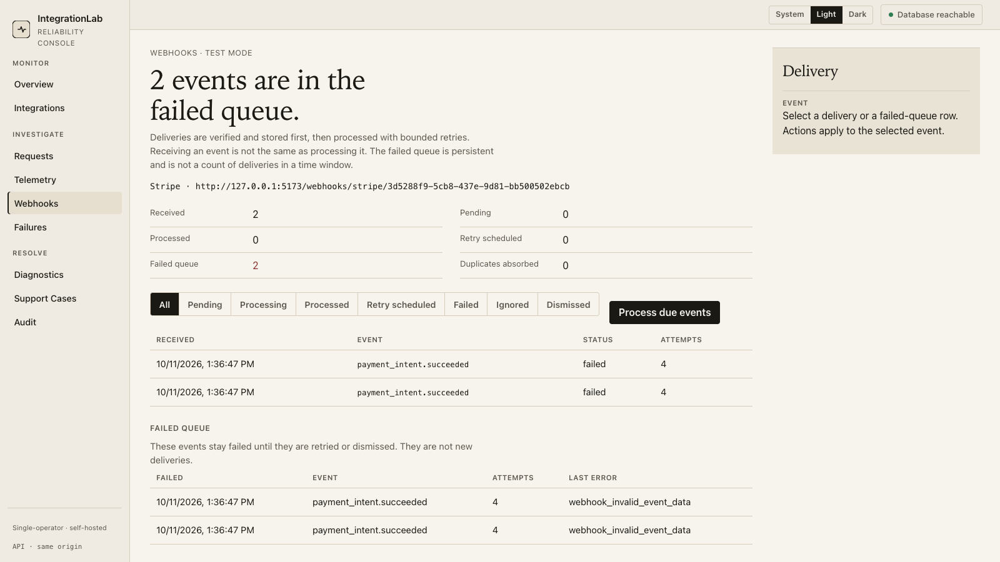
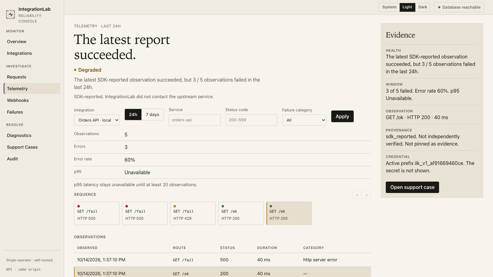
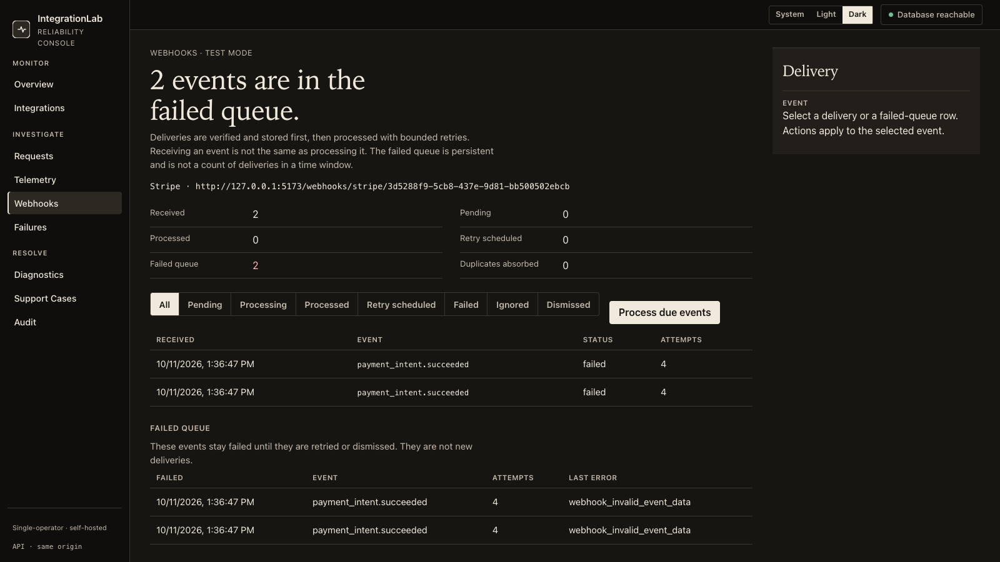
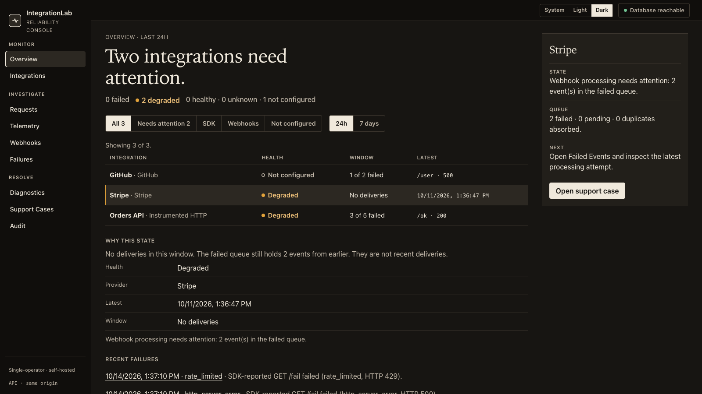
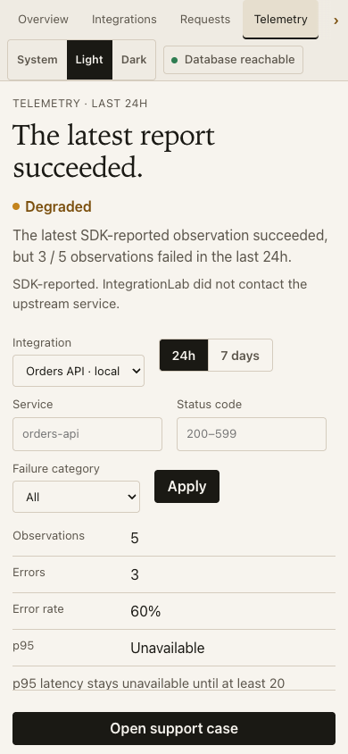
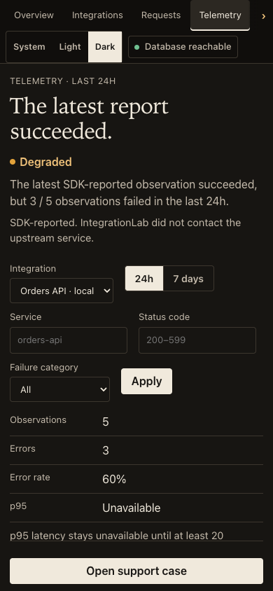
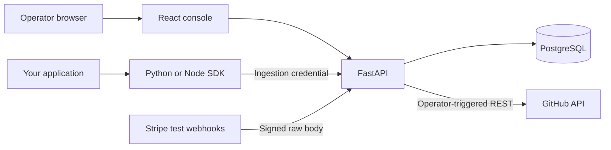

# IntegrationLab

IntegrationLab is a self-hosted console for investigating integration failures with stored evidence.

An operator can connect a GitHub OAuth App, receive signed Stripe test-mode webhooks through an endpoint, run a controlled failure simulation, and investigate what the system actually recorded. A separate application can report its own HTTP outcomes through a Python or Node SDK. Those SDK reports are labeled as reports; IntegrationLab does not call the upstream service to confirm them.

This is a local portfolio application. It is not a hosted monitoring service, and the SDK packages are not published to PyPI or npm.

[](https://github.com/ManpreetS2/IntegrationLab/actions/workflows/ci.yml)



*Current local console on `main`: Ledger UI v3, light appearance. Health comes from stored evidence; absent observations are not silently shown as healthy.*

[](docs/media/integrationlab-v2-demo.mp4)

*Historical v2 video (about 86 seconds), recorded before the Ledger UI v3 redesign. It is not a recording of the current interface.* HTTP 200, 429, 500, and timeout rows come from a local fixture. Stripe events in the video are locally signed test-mode deliveries. There is no public hosted demo.

## The problem

When a third-party integration fails, the useful question is narrow: what was observed, where did that observation come from, and what should the operator do next?

Logs from the provider, webhook deliveries, and an application's own HTTP client are three different kinds of evidence. Mixing them makes a dashboard look healthier or sicker than the record supports.

## What it does

- Keeps GitHub OAuth connection state and real `GET /user` request logs separate from simulations.
- Verifies Stripe webhook signatures on the raw body, stores the delivery, and processes it in a later recorded attempt.
- Treats a repeated delivery as a duplicate. A later event for the same object can still be a new event.
- Runs Failure Lab scenarios that are marked simulated and excluded from provider health.
- Opens a support case with pinned evidence, notes, and an audit trail.
- Registers an instrumented application, issues an ingestion credential once, and shows the HTTP outcomes that application reported.

## Ledger UI v3

The current interface uses **Ledger**, a restrained, evidence-first design across Overview, Integrations, Requests, Telemetry, Webhooks, Failures, Diagnostics, Support Cases, and Audit. The operator unlock and Failure Lab also use the same visual language. Light is warm paper and ink; dark is warm near-black. Technical identifiers and measurements use a monospaced treatment; status color is reserved for meaningful outcomes.

- **Overview:** read integration health and select records to inspect the evidence behind a state. Stripe's persistent failed queue remains distinct from deliveries in a selected time window.
- **Telemetry:** inspect SDK-reported observations, filter events, and follow the observation sequence. The interface never presents an SDK report as an independent upstream probe.
- **Failures and Webhooks:** investigate stored failures, delivery and processing outcomes, bounded retries, and supported actions without merging simulated activity into real metrics.
- **Support Cases and Audit:** create and update cases, append notes, inspect eligible pinned evidence, and review an append-only operator history. An SDK observation may inform a case summary but is not a pinnable evidence type.
- **Credentials:** create, rotate, or revoke ingestion credentials. The secret is revealed once; later views display only the credential prefix.

The Ledger redesign uses the existing v2 API contracts and backend health calculations. It does **not** add hosted monitoring, automatic webhook workers, tenant isolation, or upstream verification.





## Universal Monitoring v2

An application outside this repository uses the local Python or Node SDK to report sanitized HTTP outcomes: method, route template, status, duration, and a failure category. Query strings, bodies, cookies, and authorization headers are not stored.

The console shows those rows on **Telemetry**, not on the provider request log.

| What you see | What it means |
| --- | --- |
| `registered` | The application record exists. No active ingestion credential. This is not an OAuth connection. |
| `instrumented` | At least one ingestion credential is active. |
| `sdk_reported` | The application sent this observation. IntegrationLab did not call the remote service. |
| Error rate `Unavailable` | There were no observations in the window. That is not a 0% error rate. |
| p95 `Unavailable` | Fewer than 20 observations. The percentile is withheld. |
| Health `unknown` | Nothing was reported in the window. Silence is not health. |

Switching the selected application hides the previous application's credential prefixes and telemetry until the new response arrives.



## GitHub and Stripe

GitHub uses an OAuth App with PKCE. Tokens stay on the server. Diagnostics for GitHub can make one real `GET /user` call when the operator runs them.

Stripe uses one webhook signing secret for the process. The console shows the local endpoint and whether verification is configured. It does not show the signing secret. Duplicate deliveries are counted separately from failed processing.

Failure Lab, guided diagnostics, GitHub OAuth, and the Stripe webhook receiver are unavailable for instrumented applications. The UI disables those actions instead of pretending they apply.



## Light and dark

Ledger UI v3 has warm paper-and-ink light and warm near-black dark appearances. Choose **System**, **Light**, or **Dark** in the console. System follows the operating system, including later changes. The choice is stored in this browser.







## Architecture



The operator key and the ingestion credential are different secrets. The browser never calls the telemetry ingestion endpoint. The ingestion credential is shown once, at create or rotate, and is not written to browser storage.

Webhook receipt and webhook processing are separate. Processing is operator-triggered. There is no always-on worker.

## Stack

| Layer | Choice |
| --- | --- |
| Interface | React 19, TypeScript, Vite, custom CSS |
| API | Python, FastAPI, Pydantic, SQLAlchemy |
| Data | PostgreSQL 18, Alembic |
| SDKs | Local Python package `integrationlab` and Node package `@integrationlab/sdk` |
| Local run | Docker Compose, or a virtualenv plus PostgreSQL |
| CI | GitHub Actions: backend tests, frontend quality, both container builds, Compose smoke, Terraform validate |
| AWS | Terraform is formatted and validated in CI. It has not been applied. |

## Five-minute local start

Requirements: Docker with Compose, Git, and Python 3.

```bash
git clone https://github.com/ManpreetS2/IntegrationLab.git
cd IntegrationLab
export OPERATOR_API_KEY="$(python3 -c 'import secrets; print(secrets.token_urlsafe(32))')"
make demo
```

Open http://localhost:8080 and enter that operator key. `echo "$OPERATOR_API_KEY"` prints it again. Do not commit it.

`make demo` starts the console, API, and database, then loads GitHub and Stripe demo records and labeled simulations. It does not connect a live GitHub account or deliver a Stripe webhook.

Stop the stack without deleting the database:

```bash
docker compose -f docker-compose.full.yml down
```

`make compose-down` and `make smoke` delete the Compose volume. Do not run them against a database you want to keep.

To exercise a real GitHub OAuth App or Stripe CLI forwarding, use [docs/external-acceptance.md](docs/external-acceptance.md).

## Python SDK

Install from this checkout. The package is not on PyPI.

```bash
python -m pip install -e sdk/python
```

```python
from integrationlab import IntegrationLabClient

with IntegrationLabClient.from_env() as lab:
    with lab.observe(service="orders-api", method="GET", route_template="/v1/orders/{id}") as obs:
        response = call_your_client()
        obs.set_status(response.status_code)
    lab.flush()
```

Set these in the application process, not in the browser:

```bash
export INTEGRATIONLAB_BASE_URL=http://127.0.0.1:8000
export INTEGRATIONLAB_INTEGRATION_ID=<integration-uuid>
export INTEGRATIONLAB_INGESTION_CREDENTIAL=<paste the one-time credential>
export INTEGRATIONLAB_ENVIRONMENT=local
```

`examples/universal-monitoring/` is a separate program. It calls a local fixture that returns 200, 429, 500, and a hang, then reports those outcomes. `python3 examples/universal-monitoring/accept.py` runs that path against a database whose name ends in `_test` and an API on port 8010.

## Node SDK

Install and build from this checkout. The package is not on npm.

```bash
cd sdk/typescript && npm install && npm run build
```

```javascript
import { IntegrationLabClient } from "@integrationlab/sdk";

const lab = IntegrationLabClient.fromEnv();
const fetchObserved = lab.instrumentFetch(fetch, {
  service: "orders-api",
  routeTemplate: "/v1/orders/{id}",
});
const response = await fetchObserved("https://upstream.example/v1/orders/123");
await lab.close();
```

Use the same environment variables as the Python SDK. `fromEnv()` rejects an operator key that was passed in as the ingestion credential.

## Demo walkthrough

1. Unlock the console with the operator key.
2. On Overview, read health. A zero is neutral. A failed or degraded integration names the stored evidence.
3. On Integrations, create an Instrumented HTTP application. Status becomes Registered.
4. Generate an ingestion credential. Copy it from the dialog. Close the dialog. The list shows the prefix only.
5. Point the Python sample at that integration and run it.
6. Open Telemetry. The page identifies rows as SDK-reported. Expect degraded health for the fixture: successes, a 429, a 500, and a timeout. p95 stays unavailable.
7. Open Failures and filter to SDK-reported. The source is `sdk_telemetry`.
8. Rotate the credential. The previous secret is rejected. Revoke the replacement. Status returns to Registered. The historical rows remain.
9. Open Requests, Webhooks, Diagnostics, and Support Cases for the GitHub and Stripe records. Those pages are the provider workflows, not the SDK feed.

A shot list for a 60–90 second recording is in [docs/v2-demo-script.md](docs/v2-demo-script.md).

## Tests and CI

From a checkout with the backend virtualenv and frontend dependencies:

```bash
cd backend && python -m pytest -q
cd frontend && npm run lint && npm run test:unit && npm run build
cd sdk/python && PYTHONPATH=src python -m pytest tests -q
cd sdk/typescript && npm test
python3 examples/universal-monitoring/accept.py
```

Pytest and the acceptance script use a database whose name ends in `_test`. They refuse the application database.

GitHub Actions runs six jobs: backend tests, frontend quality, backend image, frontend image, Compose smoke, and Terraform validate. The smoke job builds its own stack and deletes that stack's volume when it finishes.

For Ledger UI v3, isolated browser/API checks covered one-time credential reveal, rotation and revocation, webhook retry and dismiss, support-case creation, notes and status changes, unauthorized operator actions, and narrow-screen presentation. **GitHub OAuth was not completed in that UI v3 browser review** because the isolated environment lacked GitHub App configuration. Passing CI does not substitute for testing a real external OAuth handshake.

The claim-to-evidence notes for earlier GitHub OAuth and Stripe CLI sessions are in [docs/verification.md](docs/verification.md). Those sessions were local. They are not a public production deployment.

## Security boundaries

- The operator key unlocks the console. The ingestion credential only submits telemetry.
- An ingestion credential presented to an operator route is rejected. An operator key presented as an ingestion credential is rejected.
- A credential for one integration cannot submit events for another.
- The server stores a SHA-256 of the ingestion secret. The secret itself is returned only from create and rotate.
- Stripe signatures are checked against the raw body. The signing secret is an environment variable, not a field in the UI.
- Route templates are stored. Full URLs, query strings, bodies, cookies, and authorization headers are not.
- One operator. No per-user RBAC, no tenant isolation, no default WAF, and one Stripe signing secret per process.

Details and the things this model does not claim are in [docs/threat-model.md](docs/threat-model.md) and [SECURITY.md](SECURITY.md).

## Known limitations

- SDK observations are not an independent probe of the upstream service.
- p95 latency is withheld below 20 observations.
- Diagnostics do not run for instrumented applications.
- Webhook processing does not run by itself.
- AWS Terraform has been validated, not applied.
- The Python and Node SDKs are installed from this repository only.
- `localhost:8080` is your machine. There is no public hosted demo.

## Roadmap

The useful next steps are narrower than a new platform: publish the SDKs only after a real package release, split Stripe signing secrets per integration, and add an operator-visible worker only when processing is actually continuous. Until then, those items stay out of the product.

[Deferred backlog](docs/phase-2-backlog.md) · [Architecture](docs/architecture.md) · [Universal monitoring contract](docs/contracts/universal-telemetry-v1.md) · [ADRs](docs/adr/)

## License

[MIT License](LICENSE). Copyright (c) 2026 Manpreet Singh.

[Contributing](CONTRIBUTING.md) · [Security](SECURITY.md)
