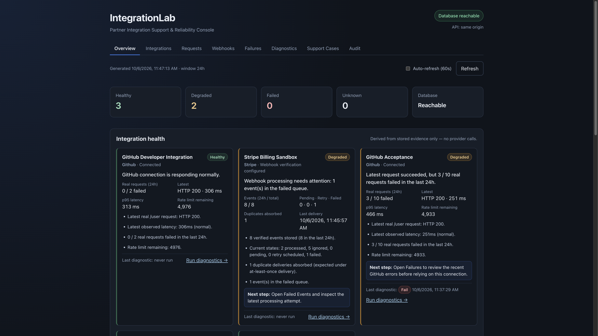
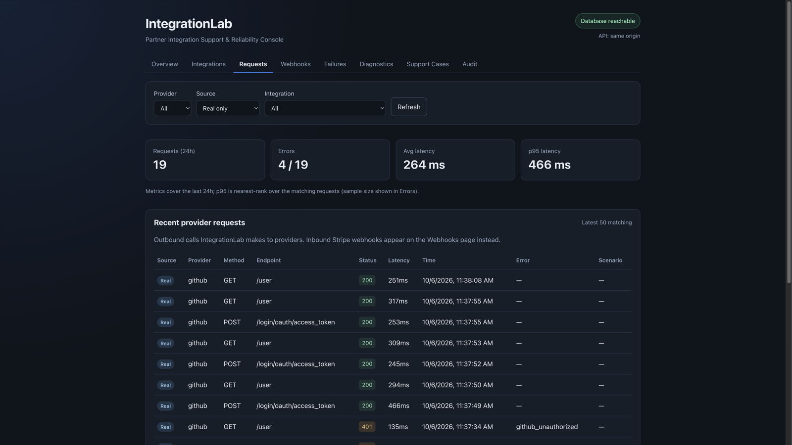
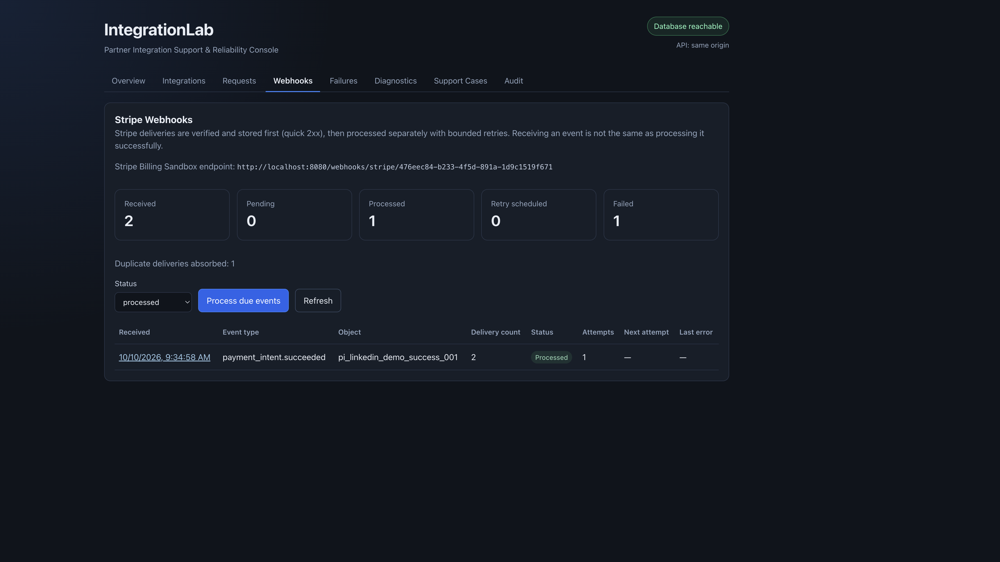
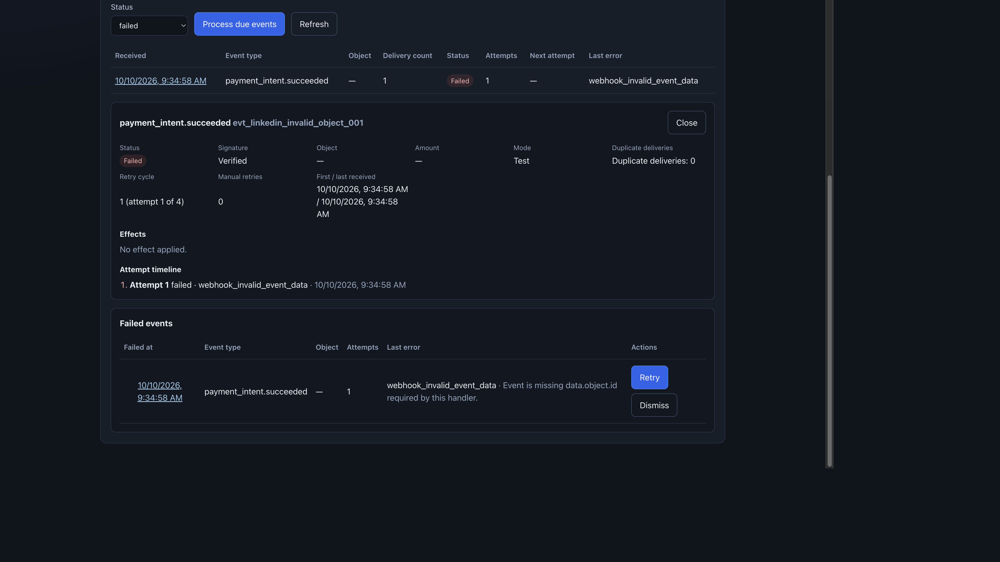
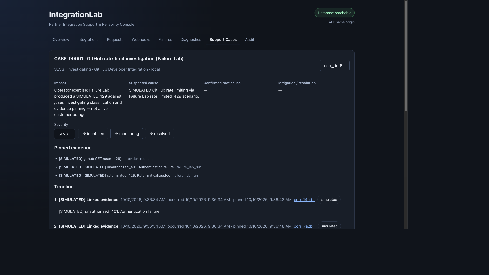
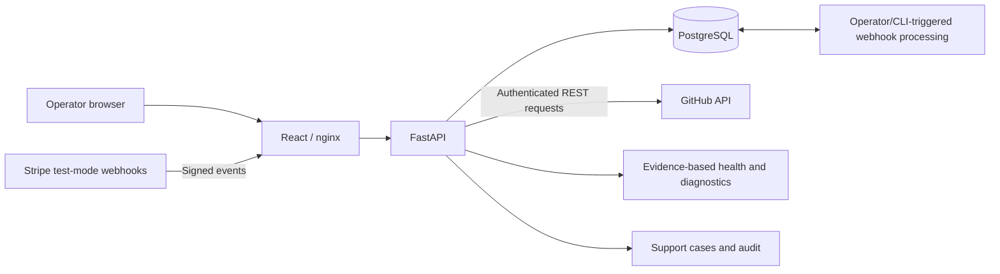

# IntegrationLab

**Debug broken integrations with evidence, not guesses.**

IntegrationLab is a **self-hosted, single-operator integration support console** built to investigate GitHub API failures and Stripe test-mode webhooks. It brings provider requests, reliability signals, guided diagnostics, incident cases, and safe recovery workflows into one React dashboard.

[](https://github.com/ManpreetS2/IntegrationLab/actions/workflows/ci.yml)



*Actual local Docker Compose UI, captured during an earlier acceptance session. This is not a public cloud service or production customer monitoring.*

**[Try it locally](#try-it-yourself) · [Screenshots](#see-it-in-action) · [Capabilities](#what-it-does) · [Architecture](#how-it-works) · [Verification](#verification) · [Engineering decisions](#engineering-decisions)**

## Try it yourself

**You can run the entire application on your own machine.** No GitHub OAuth App, Stripe account, or AWS account is required for the simulated demo.

**Requirements:** Docker with Compose, Git, Make, and Python 3. Commands below use a macOS/Linux shell (Windows users can use WSL2 with Docker integration).

```bash
git clone https://github.com/ManpreetS2/IntegrationLab.git
cd IntegrationLab
export OPERATOR_API_KEY="$(python3 -c 'import secrets; print(secrets.token_urlsafe(32))')"
make demo
```

Open **http://localhost:8080**. The dashboard will ask you to unlock it using the generated operator key. To see that key in your own terminal, use `echo "$OPERATOR_API_KEY"`. Keep it private.

**What the demo gives you:**
- A running React UI, FastAPI service, PostgreSQL database, and applied migrations via Docker Compose.
- Example GitHub and Stripe integration records.
- Deterministic **simulated** 401, 429, 500, and timeout failures with evidence-based diagnoses.
- A saved Stripe configuration/diagnostic result to explore in the UI.

`make demo` does **not** connect a real GitHub account, deliver a real Stripe webhook, or populate production traffic. You can explore the dashboard first and set up live provider tests later.

To stop the demo **without removing its database volume**:

```bash
docker compose -f docker-compose.full.yml down
```

To intentionally reset the demo **and delete its local database volume**, run `make compose-down`.

### Connect your own test integrations

The demo is optional. To exercise **real GitHub OAuth** or **Stripe test-mode signed webhooks**, configure your own provider credentials and follow the [step-by-step external acceptance runbook](docs/external-acceptance.md).

- **GitHub:** Register an OAuth App with the exact local callback, configure `GITHUB_CLIENT_ID`, `GITHUB_CLIENT_SECRET`, and `TOKEN_ENCRYPTION_KEY`, then authorize and check your own connection.
- **Stripe:** Use Stripe CLI in **test mode**, forward signed webhooks to your IntegrationLab endpoint, set `STRIPE_WEBHOOK_SECRET`, and inspect durable receipt, duplicates, processing, and failures.
- **Security:** Use a strong `OPERATOR_API_KEY` whenever provider credentials are configured. Never commit `.env` files or share credentials in screenshots.

Both integrations were previously exercised against real providers using this local Compose application; see [verification evidence](docs/verification.md). Running the simulated demo by itself is not external provider verification.

### Can I add IntegrationLab to an existing application?

**Not as a copy-paste plugin today.** This repository is a **standalone application**, not a published Python package, JavaScript SDK, generic API gateway, or drop-in payment integration.

You can run it separately to learn and test its existing GitHub and Stripe workflows. To reuse its webhook-processing approach inside another application, a developer would need to adapt the API routes, authentication, event handlers, database models, and domain-specific business effects. The included Stripe handlers record internal demo effects; they do not automatically connect to another product's payment or order system.

The intended first experience is **clone → `make demo` → explore**, without any code changes.

## See it in action

The following are real screenshots of the running local application. Captions distinguish **real provider evidence** from **synthetic/demo events**.

### 1. Reliability overview

The full-width dashboard image at the top of this README shows evidence-derived health: missing observations never become invented uptime, and Failure Lab simulations do not change live health.

### 2. Inspect real GitHub API evidence

The Requests view records safe endpoint labels, HTTP status codes, request latency, and whether an observation was real or simulated. This screenshot comes from an earlier **real GitHub OAuth/REST acceptance** session.



### 3. Follow Stripe webhook processing

The Webhooks view shows received events, processing states, and duplicate deliveries. **This screenshot uses locally HMAC-signed synthetic test events**, not a fresh Stripe CLI delivery.



### 4. Investigate the failed queue

Review a failed processing attempt, inspect its reason, and locate the operator's Retry/Dismiss controls. The event shown here is **synthetic test data**; the classification and UI workflow are implemented.



### 5. Organize a support case

A support case links evidence, notes, severity, lifecycle status, correlation IDs, and a derived timeline. This screenshot explicitly labels **SIMULATED Failure Lab** evidence and is **not a real customer outage**.



[More screenshot provenance and the complete LinkedIn image set](docs/assets/portfolio/linkedin/README.md)

## What it does

| Feature | What you can inspect or demonstrate |
| --- | --- |
| **GitHub OAuth and REST** | Authorization code + state/PKCE, encrypted access tokens, connection checks and real `GET /user` request evidence |
| **Stripe webhook reliability** | Signature verification on the raw body, durable receipt, delivery deduplication, idempotent internal effects and processing attempts |
| **Retry and recovery** | Bounded retry policy, persisted failures, inspectable failed-event queue and operator-triggered recovery |
| **Failure Lab** | Reproducible simulated failures and deterministic diagnoses without changing real provider health |
| **Reliability and diagnostics** | Passive evidence-derived health; explicit operator-triggered diagnostics instead of unannounced provider calls |
| **Support cases and audit** | Pinned evidence, status transitions, timelines, correlation IDs, and secret-safe operator audit metadata |

## How it works



Three boundaries matter:

1. **Webhook delivery is not webhook processing.** Validate the signature against the original body, store the event durably, acknowledge receipt, then process it separately through bounded, recorded attempts.
2. **Delivery deduplication is not the same as business-effect idempotency.** Repeated delivery of one event must not reapply its effect; separate events for the same object can be legitimate.
3. **Simulated evidence is not live provider evidence.** Failure Lab records are visibly marked and excluded from provider health aggregation.

Processing is **operator/CLI-triggered**, not an always-on background worker. The system is designed as a local, single-operator portfolio console, not a multi-tenant production SaaS.

### Stack

| Layer | Technology |
| --- | --- |
| Frontend | React, TypeScript, Vite, nginx |
| Backend | Python, FastAPI, SQLAlchemy, Pydantic |
| Database | PostgreSQL 18, Alembic |
| Local runtime | Docker Compose |
| CI | GitHub Actions: backend, frontend, containers, assembled-stack smoke, Terraform |
| Optional AWS design | Terraform for CloudFront, S3, ALB, ECS/Fargate, RDS, Secrets Manager and GitHub OIDC |

**AWS has not been deployed.** The Terraform architecture was formatted and validated in CI, but no `terraform apply` or cloud-runtime acceptance was performed. See the [full architecture](docs/architecture.md), [AWS deployment design](docs/aws-deployment.md), and [architecture decision records](docs/adr/).

## Verification

**Verified in October 2026:**

- **331 backend tests passed**, including OAuth, webhook signature handling, concurrency, idempotency, retries, diagnostics and support operations.
- **5 frontend unit tests passed**, plus frontend lint and production build.
- **6/6 CI jobs passed**, including the full-stack Compose smoke test with operator authentication and persisted Failure Lab/support-case flows.
- **Separate external acceptance** verified real GitHub OAuth / REST calls, Stripe CLI-signed webhook receipt, duplicate absorption, a failed event, and provider-evidence support cases.
- **Manual Stripe retry/dismiss and AWS live deployment are not externally verified**; automated coverage and implementation do not imply otherwise.

[GitHub Actions results](https://github.com/ManpreetS2/IntegrationLab/actions/workflows/ci.yml) · [Exact claim-to-evidence matrix](docs/verification.md) · [External acceptance runbook](docs/external-acceptance.md)

For contributors with the project dependencies installed:

```bash
make verify       # Backend tests, frontend quality, Terraform validation
make full-verify  # Above + Docker Compose integration smoke
```

**Caution:** the full-stack smoke workflow removes its temporary Compose database volume when it finishes. Keep important demo data in a separate stack.

## Engineering decisions

- **Why PostgreSQL instead of Redis/Kafka?** Durable receipts, concurrency-safe claims, attempts, and idempotent effects are sufficient at this project's scale without another infrastructure dependency.
- **Why deterministic diagnostics?** Operators can trace recommendations back to actual observations; the interface does not invent a root cause.
- **Why support cases?** A request log gives one symptom; pinned evidence, notes, status, and correlation preserve an investigation.
- **Why operator-triggered processing?** It demonstrates the receipt/processing boundary without pretending an always-running worker exists.
- **Why explicit limitations?** This is not a multi-tenant platform. It has no per-user RBAC, always-on worker, default WAF/rate limiting, or per-integration Stripe signing secrets.

[Threat model](docs/threat-model.md) · [Support operations](docs/support-operations.md) · [Engineering ADRs](docs/adr/) · [Deferred Phase 2 backlog](docs/phase-2-backlog.md)

## More documentation

[60-second demo and technical walkthrough](docs/demo-script.md) · [Customer case study](docs/customer-case-study.md) · [Interview Q&A](docs/interview-questions.md) · [Resume bullets](docs/resume-bullets.md) · [LinkedIn post draft](docs/linkedin-post.md)
