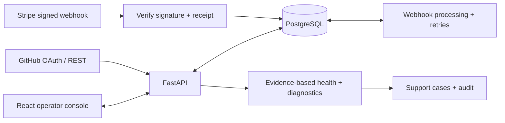

# IntegrationLab

**An evidence-first support and reliability console for third-party API and webhook integrations.**

When an integration breaks, the hard part isn't only seeing an error. It's answering **what failed, what evidence supports the diagnosis, and what an operator can safely do next.**

[](https://github.com/ManpreetS2/IntegrationLab/actions/workflows/ci.yml)


*Real application UI from the earlier local Compose acceptance session. This project is locally run; it is not a hosted SaaS or a production monitoring service.*

**Jump to:** [Screenshots](#product-walkthrough) · [Architecture](#architecture) · [Verification](#verification--tests) · [Run locally](#run-locally) · [Case study](docs/customer-case-study.md)

## The problem and the solution

Partner integrations fail because of expired credentials, provider outages, permissions, rate limits, duplicate webhooks, processing errors, and configuration mistakes. A dashboard that guesses at uptime doesn't help an operator diagnose any of them.

**IntegrationLab** brings together **durable provider evidence, deterministic reliability signals, guided diagnostics, a Failure Lab, support cases, and audit trails**. It's a single-operator portfolio project designed to demonstrate integration engineering and customer-facing technical troubleshooting.

## What it does

| Area | Capability |
|---|---|
| **GitHub OAuth** | Authorization code, state + PKCE, Fernet-encrypted access tokens, connection checks, real `GET /user` evidence |
| **Stripe webhooks** | Raw-body signature verification, durable receipt, repeated-delivery counting, separate processing, bounded retries, failed queue |
| **Reliability** | Health derived from stored observations; missing evidence is `unknown` rather than invented uptime |
| **Failure Lab** | Deterministic 401, 429, timeout, and provider 500 simulations; explicitly labeled and excluded from real health |
| **Support workflow** | Persisted diagnostics, evidence pins, `CASE-#####` lifecycle, notes, derived timeline, correlation IDs, operator audit |

## Product walkthrough

| Real GitHub provider request | Support-case investigation |
|:--|:--|
|  |  |
| **Prior real GitHub OAuth/REST acceptance**; request evidence is separated from simulated data | **Real local application workflow**, with `SIMULATED` evidence clearly marked, not a customer incident |

| Stripe webhook processing | Failure recovery queue |
|:--|:--|
|  |  |
| **Locally HMAC-signed synthetic events** through the working webhook pipeline, not a fresh Stripe CLI delivery | Working operator controls and failure classification over synthetic test events |

[View all five LinkedIn screenshots, descriptions, and precise provenance](docs/assets/portfolio/linkedin/README.md).

**Separate earlier external acceptance** verified real GitHub OAuth and REST calls plus real Stripe CLI-signed deliveries, duplicate absorption, failed-event classification, and cases based on provider evidence. See the [verification evidence matrix](docs/verification.md). These screenshots do not imply production customer traffic.

## Architecture



Two important design boundaries:

- **Delivery deduplication ≠ business-effect idempotency.** Duplicate deliveries of the *same Stripe event* do not create new effects. Distinct events about the same object can still represent legitimate separate operations.
- **Simulated evidence ≠ provider evidence.** Failure Lab results are marked `SIMULATED` and excluded from live health aggregation.

Stripe receipt and processing are separated: verify the original raw HTTP body → durably store an event → claim work using PostgreSQL row locks → record attempts and idempotent internal effects → bounded retries or failed queue. Processing is **operator/CLI-triggered**, not a continuously running worker.

| Layer | Technology |
|---|---|
| UI | React, TypeScript, Vite, nginx |
| API | Python, FastAPI, SQLAlchemy, Pydantic |
| Storage | PostgreSQL 18, Alembic |
| Integrations | GitHub OAuth/REST, Stripe test-mode webhooks |
| Local runtime | Docker Compose: Postgres → migrations → API → frontend |
| Automation | GitHub Actions with six CI jobs |
| Infrastructure as code | Terraform for CloudFront, S3, ALB, ECS/Fargate, RDS, Secrets Manager and GitHub OIDC |

Terraform defines the AWS architecture, but **AWS was not deployed or applied**. Details: [architecture](docs/architecture.md), [ADRs](docs/adr/), [deployment design](docs/aws-deployment.md).

## Verification & tests

**Latest verified results (October 2026):**

- **331 backend tests passed** against PostgreSQL, covering OAuth, Stripe signatures and delivery handling, concurrency, retries, diagnostics, and support operations.
- **5 frontend unit tests passed** using the production TypeScript amount formatter, plus lint/type-check/production build.
- **6/6 GitHub Actions jobs passed**: backend tests, frontend quality, backend container, frontend container, full-stack smoke, and Terraform quality.
- **Full-stack smoke passed** for the assembled Compose stack: operator auth, migrations, API, Failure Lab evidence, reliability summaries, and support case workflow.
- **Previously verified with real providers:** GitHub OAuth / `GET /user` / revoke-reconnect, Stripe CLI-signed webhook delivery, duplicate detection and failure evidence, and a support case linked to real evidence.

[See CI runs](https://github.com/ManpreetS2/IntegrationLab/actions/workflows/ci.yml) · [Claim-to-evidence matrix](docs/verification.md) · [External acceptance runbook](docs/external-acceptance.md)

Unit tests and CI checks do not mean the project is publicly hosted, fully production tested, or connected to providers continuously.

## Run locally

Requires Docker with Compose and Python 3 for optional demo population. You can launch the system without real GitHub or Stripe credentials.

```bash
git clone https://github.com/ManpreetS2/IntegrationLab.git
cd IntegrationLab
cp .env.example .env

# Generate a private operator key, especially if configuring provider secrets
export OPERATOR_API_KEY="$(python3 -c 'import secrets; print(secrets.token_urlsafe(32))')"

make compose-up
# Open http://127.0.0.1:8080 and unlock with OPERATOR_API_KEY
```

Populate a deterministic, **clearly simulated** dataset if desired:

```bash
make demo
```

For real GitHub OAuth or Stripe **test-mode** webhooks, follow [external acceptance](docs/external-acceptance.md). Local Compose ports bind to `127.0.0.1`; do not commit secrets.

```bash
make verify       # backend + frontend + Terraform checks
make full-verify  # above + assembled Docker Compose smoke
```

The smoke test removes its temporary stack and volume; use a separate demo stack for data you need to retain.

## Engineering decisions

- **PostgreSQL instead of Redis/Kafka in v1:** durable receipts, concurrency-safe claims, retry state, and effect keys without extra services.
- **Evidence over fake metrics:** unknown status when real observations are missing, and simulations never affect real health.
- **Support cases over raw logs:** link diagnostics and evidence to an investigation with notes, status, timestamps, and correlation.
- **Security boundaries:** OAuth state + PKCE, encrypted provider tokens, raw-body Stripe signatures, a single-operator Bearer gate, and allowlisted audit metadata.
- **Deliberate limitations:** not multi-tenant; no per-user RBAC, always-on webhook worker, default WAF/rate limiting, or per-integration Stripe signing secrets. AWS design has not been deployed.

[Threat model and residual risks](docs/threat-model.md) · [Engineering ADRs](docs/adr/) · [Deferred Phase 2 backlog](docs/phase-2-backlog.md)

## Explore further

[Demo script](docs/demo-script.md) · [Technical interview Q&A](docs/interview-questions.md) · [Customer support case study](docs/customer-case-study.md) · [Support operations](docs/support-operations.md) · [Resume bullets](docs/resume-bullets.md)
